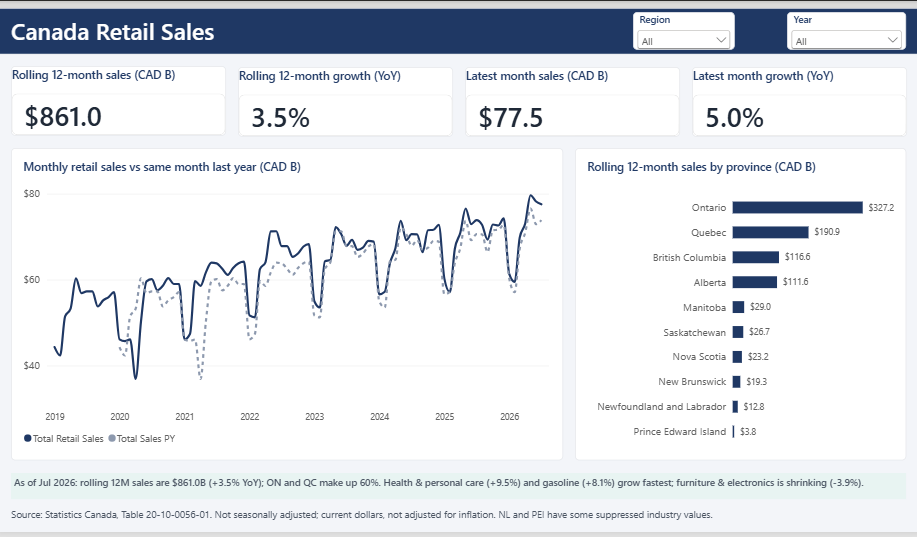
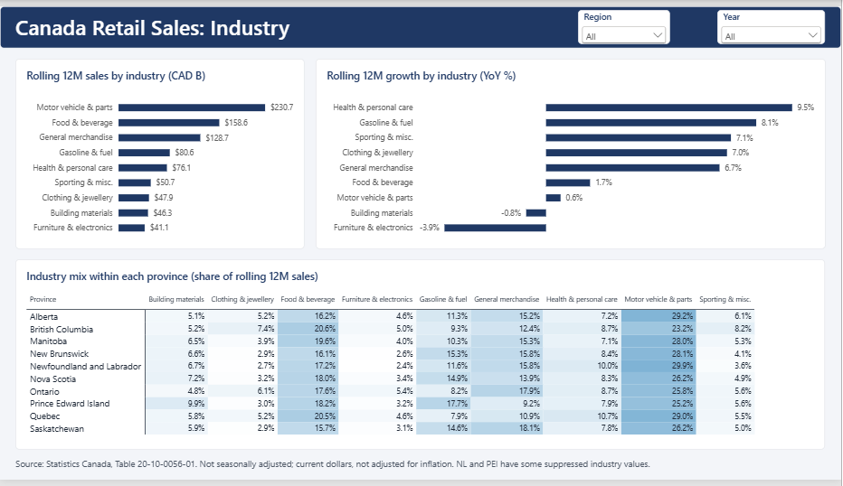
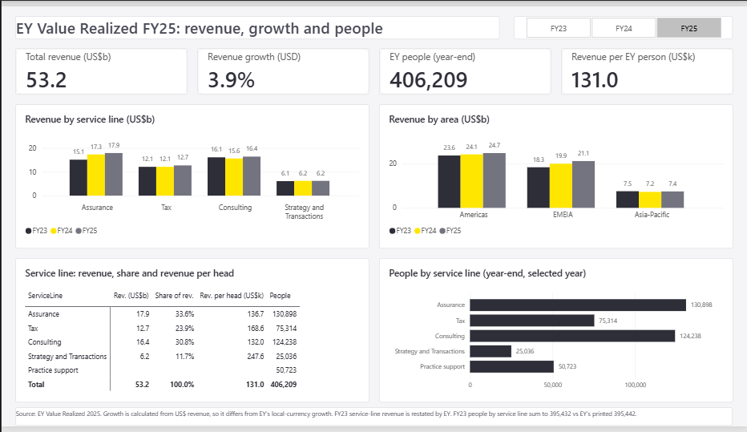

# Canada Retail Sales: Power BI report

A two-page Power BI report built from public Statistics Canada data — monthly retail trade sales by province and industry group, January 2019 to July 2026 (91 months).

## Key findings (as of July 2026)
- Rolling 12-month retail sales are **$861.0B**, up **+3.5% year-over-year**
- Ontario and Quebec together make up **~60%** of national retail sales
- Fastest-growing industries: **Health & personal care (+9.5%)** and **Gasoline & fuel (+8.1%)**
- - **Furniture, electronics & appliances** (−3.9%) and **Building materials** (−0.8%) are the only industry groups shrinking
## What's in the report
- **Overview page:** KPI cards (latest-month sales, latest-month YoY growth, rolling 12-month sales, rolling 12-month YoY growth), monthly sales vs same month last year, rolling 12-month sales by province, with slicers
- **Industry page:** rolling 12-month sales by industry, rolling 12-month growth (YoY %) by industry, and a matrix of industry mix within each province (share of rolling 12M sales)

## Data
- Source: Statistics Canada, Table 20-10-0056-01 (monthly retail trade sales by province and territory), downloaded 12 October 2026 as CSV.
- Values are unadjusted (not seasonally adjusted), in current dollars (not inflation-adjusted), reported in thousands of CAD.
- `Canada_Retail_Sales_Clean.xlsx` holds the model tables: a fact table of 8,190 rows (month × province × industry), reported province totals, province and industry dimensions, a data-notes sheet, and a checks sheet reconciling the 9 industries against the reported total.
- Only the 9 top-level NAICS retail groups (441, 444, 445, 449, 455, 456, 457, 458, 459) are used; sub-industries were excluded so nothing is double-counted.

## Limitations
- Where Statistics Canada suppressed a value, the cell is left blank, not zero (100 such cells). Newfoundland and Labrador has no published values for Building materials (444) or Furniture/electronics (449) in any month, and PEI has partial gaps — so for province totals the report uses the reported totals, not the sum of industries.
- Statistics Canada quality codes (A = best to E = use with caution) are kept in the dataset as published.
- Because the data is not seasonally adjusted, month-to-month comparisons are misleading; the report leans on rolling 12-month totals and year-over-year growth instead.

## Tools
Power BI Desktop, DAX, Excel

# EY Value Realized FY25: Power BI report

A one-page Power BI report built from public figures in EY's *Value Realized 2025* report (revenue by service line and area, and headcount, FY23 to FY25).

## Key findings
- Global revenue grew from **US$49.4B (FY23)** to **US$51.2B (FY24)** to **US$53.2B (FY25)**
- **Assurance** is the largest service line in FY25 at **US$17.9B** (~34% of revenue), overtaking Consulting, which led in FY23
- **Americas** accounts for 46% of FY25 revenue (US$24.7B), followed by EMEIA (US$21.1B) and Asia-Pacific (US$7.4B)
- Year-end headcount reached **406,209** in FY25, up from 393,025 in FY24
- **Strategy and Transactions** has the highest revenue per head (~US$248K) despite being the smallest service line by revenue

## What's in the report
- Year slicer (FY23 / FY24 / FY25) driving the KPI cards, the service-line table and the headcount chart
- KPI cards: total revenue, revenue growth (USD), year-end headcount, revenue per EY person
- Revenue by service line and by area, FY23 to FY25
- Service-line table: revenue, share of revenue, revenue per head, headcount

## Data
- Source: EY Value Realized 2025 (revenue on page 7, people metrics on page 66). All figures were typed in by hand from the PDF.
- `EY_Value_Realized_FY25_Data.xlsx` holds the model tables: 3 dimensions (fiscal year, service line, area) and 3 fact tables (revenue by service line, revenue by area, headcount). The `Source_and_Checks` sheet reconciles the totals — the service-line and area breakdowns each sum exactly to EY's reported totals for all three years (difference = 0).
- Star schema in Power BI, with DAX measures in a `_Measures` table.

## Limitations
- Revenue is published only in US$ billions rounded to one decimal, so derived figures such as revenue per head are approximate.
- Growth in the report is calculated from US$ revenue. EY's printed growth is in local currency, so the two differ (for example 3.9% here vs 4.0% printed for FY25).
- EY restated FY23 service-line revenue, so FY23 to FY24 service-line comparisons are on EY's restated basis. The PDF's printed FY23 to FY24 headcount growth also does not match its printed values (FY24 headcount was restated), so growth is computed from the stored values.
- FY23 headcount by service line sums to 395,432, but EY prints a total of 395,442. The figures are stored as printed.
- EY publishes no service line by area breakdown, so those visuals cannot cross-filter each other.
- Revenue per EY person divides total revenue by all headcount, including Practice support.

## Tools
Power BI Desktop, DAX, Excel

## EY Value Realized FY25

